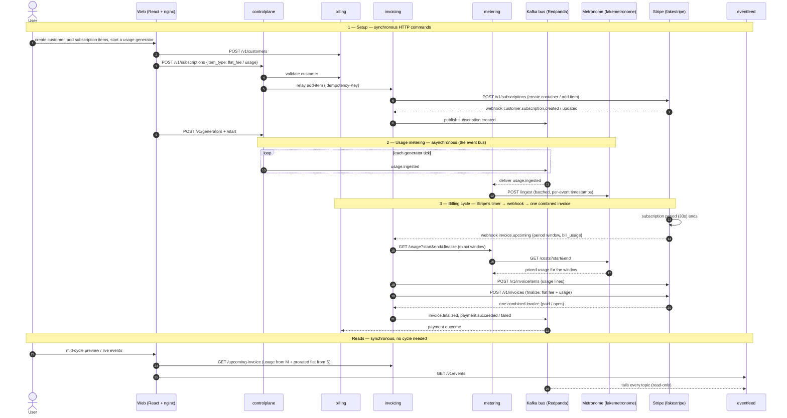

# stripe_metronome

An event-driven billing platform: it meters usage in **Metronome** (the `metering`
service), manages customers and billing cycles in the `billing` service, and
invoices + collects payment through **Stripe** (the `invoicing` service). Usage
flows over a Kafka event bus; provider calls go to local Metronome/Stripe
stand-ins (`fakemetronome` / `fakestripe`).

It's a working demo — single box, in-memory state (see *Production scaling*) — not
a production system.

## Architecture (components & event flow)

A component-level (≈ C4 Level 3) view, drawn as a sequence so the event-driven
dynamics are visible: **solid arrows are synchronous HTTP** (commands and reads),
**dashed arrows are asynchronous** (Kafka delivery, Stripe webhooks, responses).
The static breakdown of each component is in *Services* below.



The key shape: **commands are directed and synchronous (HTTP), facts are
broadcast and asynchronous (Kafka events + Stripe webhooks)** — see *Billing
periods & windowed usage* for why Stripe's subscription period drives invoicing.

## Services

Each service is its own binary under `cmd/`. The **billing pipeline** flows over
the event bus (`internal/events`); **reads and provider calls** are synchronous
HTTP (e.g. `invoicing → metering`, `metering → fakemetronome`, `controlplane →
billing` for customer validation).

| Service     | Binary            | Default addr | Responsibility |
|-------------|-------------------|--------------|----------------|
| `billing`   | `cmd/billing`     | `:8080`      | Business/orchestration. Owns the **customer registry** (`/v1/customers` — unique customers + provider-id mapping) and payment tracking. Not in the usage-data path; does not manage generators; does **not** assemble invoices. |
| `invoicing` | `cmd/invoicing`   | `:8081`      | The Stripe integration. Owns the invoice **and the flat-fee subscription link record** (its id ↔ Stripe subscription id ↔ customer). Creates/cancels subscriptions in Stripe over HTTP; reacts to Stripe **webhooks** (`POST /webhooks/stripe`): `customer.subscription.created` and `invoice.upcoming`. At each subscription's period boundary it pulls that window's usage from Metronome, pushes it to Stripe as invoice items, and finalizes one invoice (fee + usage), mapping the outcome onto the bus. Calls `STRIPE_BASE_URL` + `METERING_SERVICE_URL`. |
| `metering` | `cmd/metering`   | `:8082`      | Metering only (invoicing disabled). Ingests usage, determines lateness, and reads mid-period priced usage from Metronome's **list-costs** endpoint. Calls `METRONOME_BASE_URL`. |
| `fakemetronome` | `cmd/fakemetronome` | `:8083`  | Local stand-in for the Metronome API: `POST /ingest` (dedup + batching) and `GET /v1/customers/{id}/costs` (list-costs). Usage is stored per-event with its timestamp, so costs can be queried for an **arbitrary window** (`?start=&end=`) — that's what lets a caller bill usage for a period defined by Stripe. Swap via `METRONOME_BASE_URL`. |
| `fakestripe` | `cmd/fakestripe`     | `:8084`  | Local stand-in for the Stripe API (invoice items, invoice create/finalize, payment outcome). Swap for real Stripe test mode via `STRIPE_BASE_URL`. |
| `controlplane` | `cmd/controlplane` | `:8085`  | Control plane for **usage generator** processes (`/v1/generators`): they tick and publish `usage.ingested`. Also relays **subscription item** add/remove (`/v1/subscriptions`, `/v1/subscriptions/remove-item`) to the invoicing service (which owns the subscription container). Frontend calls it directly. |
| `eventfeed` | `cmd/eventfeed`   | `:8086`  | **Read-only** live view of the bus. Tails every event topic into a bounded in-memory ring (last ~500) and serves it at `GET /v1/events` for the frontend's **Live events** panel. Consumes only — no produce path — so it is safe to expose publicly (this is the recruiter-facing way to watch events, in place of the Console). |

Override a listen address with `<SERVICE>_HTTP_ADDR` (e.g. `BILLING_HTTP_ADDR`).

## Event flow

Services publish/subscribe to domain events (each event type is a Kafka topic).
Reads (mid-cycle preview, invoice history) are synchronous HTTP; the bus carries
the billing pipeline. `metering` and `invoicing` call the provider stubs
(`fakemetronome` / `fakestripe`) over HTTP; those mirror the real Metronome /
Stripe APIs.

```
control     frontend ─HTTP─▶ controlplane (/v1/generators…)      provision / start / stop
(HTTP)      frontend ─HTTP─▶ billing (/v1/customers)            customers

usage       controlplane usage process ─usage.ingested─▶ [bus] ─▶ metering
(bus)                                                              └─(batch)─▶ Metronome  (meter, per-event + timestamp)

subs        frontend ─HTTP─▶ controlplane ─HTTP─▶ invoicing ─create/cancel─▶ Stripe
(cmd+event)          Stripe ─webhook (subscription.created)─▶ invoicing ─subscription.created─▶ [bus]

mid-cycle   frontend ─HTTP─▶ invoicing (/v1/customers/{id}/upcoming-invoice)
(read)                        ├─ usage (since last finalize) ◀── metering ◀── Metronome
                              └─ subscriptions ◀── Stripe

period end  Stripe advances a subscription's period (timer) ─webhook (invoice.upcoming)─▶ invoicing
(provider     invoicing ── pull usage for [period_start, period_end) ◀── metering ◀── Metronome
 driven)      invoicing ── push usage items, then finalize ─▶ Stripe   (invoice = fee + usage)
              invoicing ─invoice.finalized, payment.succeeded/failed─▶ [bus] ─▶ billing
```

Notes:
- **The provider owns the billing cycle.** There is no manual "close": each Stripe
  subscription has its own period (30s in the demo); when it ends, Stripe fires an
  `invoice.upcoming` webhook and `invoicing` finalizes one invoice = the flat fee
  **+** that period's usage. See *Billing periods & windowed usage*.
- **Usage is billed for an exact window.** `invoicing` queries Metronome for
  `[period_start, period_end)`, so Metronome's own schedule need not match Stripe's.

Event types live in `internal/events/event.go`, each doubling as its Kafka topic
name. Two `Bus` implementations sit behind one interface:

- `InMemoryBus` (`bus.go`) — single-process local dev / tests (`BUS=memory`, default).
- `KafkaBus` (`kafka.go`, franz-go) — cross-process via a Kafka-API broker
  (`BUS=kafka`, `KAFKA_SEEDS=...`). The Docker stack runs **Redpanda** as the
  broker. Two ways to watch messages propagate:
  - **Live events** panel in the web app — a read-only tail served by the
    `eventfeed` service (`GET /v1/events`), safe to expose publicly.
  - **Redpanda Console** — a fuller UI, but its buttons can create/delete topics,
    so it is bound to **localhost only** (reach it via SSM port forwarding when
    deployed; see the Terraform `console_tunnel` output).

## Layout

```
cmd/            service entrypoints (one binary each)
internal/
  app/          shared HTTP run loop (graceful shutdown, /healthz)
  config/       env-based configuration
  events/       event types + bus contract, in-memory + Kafka implementations
  billing/      billing orchestration service (usage ingest, cycle boundary)
  invoicing/    Stripe invoicing integration
  metering/    Metronome metering integration
  fakemetronome/ local stand-in for the Metronome API
  fakestripe/   local stand-in for the Stripe API
  controlplane/ control plane for usage generators; relays subscription commands
web/            React + Vite + TypeScript frontend (usage dashboard)
infra/terraform/ provisions the demo EC2 instance (t4g.small)
```

## Getting started

Backend:

```sh
make build          # build all service binaries into ./bin
make run-billing    # or run-invoicing / run-metering / run-controlplane / run-fake*
make vet            # go vet ./...
```

Frontend:

```sh
make web-install    # npm install (in ./web)
make web-dev        # vite dev server (proxies /v1 to billing; full routing needs the Docker stack's nginx)
```

## Run the full stack (Docker Compose)

Brings up Redpanda + Console + all services (on the Kafka bus) + the web app:

```sh
docker compose up --build        # add -d to run in the background
```

### Viewing the two UIs locally

Both UIs are served straight from the Compose stack — no tunnel needed locally:

- **Billing Console (the app)** → <http://localhost/> &nbsp;*(port 80, the `web`
  container)*. The main demo UI: customers, generators, subscriptions, invoices,
  and a read-only **Live events** panel (the Kafka tail served by `eventfeed`).
- **Redpanda Console** → <http://localhost:8080> &nbsp;*(the `console` container)*.
  A fuller broker UI to browse topics (`usage.ingested`, `subscription.created`,
  `invoice.finalized`, …) and inspect individual messages, partitions, and offsets.

The Redpanda **Kafka broker** itself is published on `localhost:19092` for Kafka
tooling (`kcat`, a local `rpk`, …) — it speaks the Kafka wire protocol, so it's not
a web page; don't open it in a browser.

> **If <http://localhost:8080> doesn't load** but the app on :80 does, the `console`
> container is likely a stale one started without its port mapping. Recreate it to
> apply the current Compose config:
> ```sh
> docker compose up -d --force-recreate console   # then reload http://localhost:8080
> ```
> (A plain restart or `up` can silently reuse an old container; `--force-recreate`
> — on `console` or the whole stack — guarantees it matches `docker-compose.yml`.)

The Redpanda Console is bound to **localhost only** (`127.0.0.1:8080`), so on the
deployed EC2 instance it isn't exposed publicly — reach it there by forwarding its
port over AWS SSM (see the Terraform `console_tunnel` output), then open
<http://localhost:8080>.

### Watch the billing lifecycle

Use the app at <http://localhost/> to create a customer, provision a generator,
and start/stop it, or drive it with curl as below.

**1. Create a customer** (the canonical, unique record everything ties to). The
customer registry is in-memory — not durable across restarts:

```sh
CUST=$(curl -s -X POST http://localhost/v1/customers -d '{"name":"Acme Inc"}' | jq -r .id)
```

**2. Provision + start a generator process** for that customer (provisioning is
rejected for an unknown customer). It publishes `usage.ingested` every
`interval_ms`; metering meters it:

```sh
ID=$(curl -s -X POST http://localhost/v1/generators \
      -d "{\"customer_id\":\"$CUST\",\"interval_ms\":2000}" | jq -r .id)
curl -X POST http://localhost/v1/generators/$ID/start
```

Watch `usage.ingested` populate in the app's **Live events** panel (or the
Console). Stop it anytime: `curl -X POST http://localhost/v1/generators/$ID/stop`.

**3. Check the mid-cycle invoice** (the thing Stripe alone can't show) — the
`invoicing` service reads priced usage from Metronome (list-costs) + active
subscriptions and previews what would be billed:

```sh
curl http://localhost/v1/customers/$CUST/upcoming-invoice
# {"amount_cents":9,"amount_micros":90000,"lines":[
#   {"description":"Usage-based Billing · gen 1a2b3c4d","quantity":900,"amount_micros":90000,"unit_price_micros":100}],
#  "upcoming":true,...}
```

**4. Add subscription items** (a `flat_fee` and a `usage` item — together they
define the customer's one container and its billing cycle). Created control plane →
invoicing → Stripe, confirmed back via webhook (idempotent via the `Idempotency-Key`
header). The container gets its own **30-second billing period** anchored at creation:

```sh
curl -s http://localhost/v1/subscription-plan            # {"amount_cents":3000,"currency":"usd"}
curl -s -X POST http://localhost/v1/subscriptions -H "Idempotency-Key: $(uuidgen)" \
  -d "{\"customer_id\":\"$CUST\",\"item_type\":\"flat_fee\"}" | jq .   # creates the container
curl -s -X POST http://localhost/v1/subscriptions -H "Idempotency-Key: $(uuidgen)" \
  -d "{\"customer_id\":\"$CUST\",\"item_type\":\"usage\"}" | jq .      # adds the usage item
curl -s http://localhost/v1/customers/$CUST/subscriptions | jq .   # one record: items [flat_fee, usage]
```

**5. Wait for the period to end — no manual step.** When the subscription's 30s
period elapses, Stripe fires `invoice.upcoming`; `invoicing` pulls that window's
usage from Metronome, pushes it to Stripe as invoice items, and Stripe finalizes
**one** invoice = the flat fee **+** the period's usage:

```sh
curl -s http://localhost/v1/customers/$CUST/invoices | jq '.[0].lines'
# [ {"description":"Usage-based Billing · gen 1a2b3c4d (period 1)", ...},
#   {"description":"Flat-fee Subscription", "amount_micros":30000000} ]
```

Watch the chain light up in the **Live events** panel: `invoice.finalized →
payment.succeeded`, unprompted. Metering + pricing (`fakemetronome`) and the
invoice (`fakestripe`) are real; only the provider APIs are stubbed. Cancelling a
subscription (`POST /v1/subscriptions/{id}/cancel`) fires a final `invoice.upcoming`
that bills the **prorated** partial period + its usage, then drops the subscription.

**Payment failure branch:** a customer whose id contains `fail` doesn't pay (e.g.
create one named "Fail Co"), so its invoice ends on `payment.failed`.

> **Note:** usage is billed by the subscription's period, so a customer with usage
> but **no** subscription has no billing cycle and won't be invoiced — see
> *Billing periods & windowed usage*.

## Pricing & rounding

Money is carried in **micros** (1 USD = 1,000,000 micros; 1¢ = 10,000 micros),
and the flow follows the standard **utility / telecom model: price at high
precision, sum, and round to the currency's smallest unit exactly once.**

- **Price** — Metronome (`fakemetronome`) rates each metered group at
  `unit_price_micros` (here 100 micros = $0.0001 per API request) and returns
  `usage_micros` with **no rounding**.
- **Sum** — Stripe (`fakestripe`) adds each line's micros (usage lines +
  subscription lines) into a single micros total.
- **Round once** — only the **invoice total** is rounded to whole cents
  (`amount_due = round(Σ micros ÷ 10,000)`), like an electricity bill priced in
  mills but charged to the cent.

Why it matters: rounding **per unit or per line** would drop sub-cent usage (13
requests at $0.0001 = $0.0013 → $0.00) and, at volume, distort the bill. Rounding
the **total once** bounds the rounding error to **less than half a cent per
invoice** regardless of how many events or line items there are. The mid-cycle
preview shows the precise per-line micros amounts (so freshly emitted usage is
visible immediately) alongside the rounded total; the finalized invoice bills the
rounded total and skips zero-cent invoices (Stripe won't take a $0 charge).

The other lever real providers use — a **coarser billing unit** (e.g. "per 1,000
requests") so sub-cent amounts rarely arise — is not used here; this project keeps
the fine-grained per-request unit and relies on precise summation instead.

**Subscriptions are containers with items.** A subscription is **one container per
customer** with a billing period, holding a `flat_fee` item and/or a `usage`
(metered) item — like a real Stripe Subscription with SubscriptionItems. The
billing cycle belongs to the *container*, so all its items bill on **one combined
invoice** each period. This is what lets flat-fee and usage bill together, and lets
either be added or removed without disturbing the other.

- **Flat fee**: **$30** per full 30-second period, prorated **time-based at
  $1/second**. An item present for the whole period bills the full $30; one added
  mid-period bills for the seconds remaining (added 10s in → $20). The mid-cycle
  preview shows the flat fee accruing $1/s.
- **Add an item** (`POST /v1/subscriptions {customer_id, item_type}`): creates the
  container if the customer has none, else adds the item (idempotent via the
  `Idempotency-Key` header). Stripe prorates a mid-period flat-fee add.
- **Remove an item** (`POST /v1/subscriptions/remove-item {customer_id, item_type}`):
  removing the flat-fee item stashes its prorated partial to bill on the *next*
  combined invoice (`Flat-fee Subscription (proration)`), and the container keeps
  running on the usage item — usage keeps billing. The subscription ends only when
  its **last** item is removed (a final invoice, then the container is dropped).

`fakestripe` owns the container (period, items, the ticker, the webhooks);
`invoicing` keeps a link record and finalizes each period's combined invoice.

## Billing periods & windowed usage

The hard part of composing two billing systems is that **you can't assume
Metronome's usage schedule matches Stripe's subscription schedule** (different
anchors, grace windows, cadence). This project resolves that by picking a single
authority: **the Stripe subscription's period is the billing cycle**, and Metronome
is treated as a metering store queried for that exact window.

- Each Stripe subscription (`fakestripe`) has its own period — **30 seconds** in
  the demo, anchored at creation (compressed so a cycle is watchable). Stripe rolls
  it forward like `current_period_end`.
- At each boundary Stripe fires an **`invoice.upcoming`** webhook. `invoicing`
  reacts: it queries Metronome for usage in `[period_start, period_end)`, pushes
  those as invoice items, and Stripe finalizes **one** invoice = the subscription
  fee **+** that period's usage. This mirrors how you'd add externally-metered
  usage to a Stripe subscription invoice before it finalizes.
- Because usage is pulled for an **arbitrary window**, Metronome's own schedule
  never has to align with Stripe's. `fakemetronome` stores each event with its
  timestamp and aggregates over any `[start, end)`; a `billedThrough` watermark
  makes the mid-cycle preview reset once a period is finalized.

Example use case: a customer starts a monthly subscription, then begins metered
usage 10 days in. At the subscription's month end, the invoice carries the flat fee
**and** the 10-days-in-to-month-end usage — one invoice, because the subscription
period defined the window and usage was pulled for exactly it.

Known simplifications: usage is billed **by the subscription's period**, so a
customer with usage but no subscription has no billing cycle (it wouldn't be
invoiced); with multiple subscriptions on one customer, the first period to close
sweeps up the customer's pending usage. A production build would give usage its own
period authority and tie usage to a specific subscription item. The demo also does
not model Metronome's grace window for late-arriving events.

## Metronome API fidelity

`fakemetronome` is meant to only do what the real Metronome API can do:

- **`POST /ingest`** mirrors real Metronome (`v1.usage.ingest`): event shape
  (`transaction_id`, `customer_id`, `timestamp`, `event_type`, `properties`),
  ≤100-event batches, `transaction_id` dedup, and grouping by event **properties**.
- **`GET /v1/customers/{id}/costs`** mirrors real Metronome's **list-costs**
  (`v1.customers.listCosts`) — a faithful subset returning priced usage as
  `data[].line_item_breakdown[]` (`name`, `groups`, `quantity`, `unit_price`,
  `cost` in USD), and it accepts a **time window** (`?start=&end=`) like the real
  API. `invoicing` uses the unwindowed read for the mid-cycle preview and the
  windowed read to bill a subscription period exactly.

**Known deliberate divergences:** the fake dedups `transaction_id` indefinitely
(real: 34-day window), doesn't reject future-dated or >34-day-old events, and uses
one hardcoded rate instead of configured rate cards. It also has no billing/invoice
concept of its own — the demo lets Stripe's subscription period drive invoicing and
pulls Metronome usage for that window, rather than using Metronome-native billing.

## Deploy to an AWS t4g.small

The stack is memory-tuned for a 2 GB `t4g.small` (free via the EC2 T4g trial
through Dec 31 2026 — 750 hrs/month ≈ one always-on instance).

**Terraform** (`infra/terraform/`) provisions the instance, security group, IAM
role, swap, and Docker, and can self-deploy on boot (clone + `docker compose up`).
Management is via **AWS SSM (Session Manager)** — no SSH, no key pair, and no
dependency on a static IP. See that directory's README. To do it by hand instead,
on the instance:

1. Add swap for headroom: `sudo fallocate -l 2G /swapfile && sudo chmod 600 /swapfile && sudo mkswap /swapfile && sudo swapon /swapfile`.
2. Install Docker + the compose plugin.
3. `docker compose up --build -d`.
4. Security group inbound: only `80` (app). Recruiters watch events via the app's
   read-only **Live events** panel. The Console is bound to localhost — reach it by
   forwarding its port over SSM (`console_tunnel` output); leave `19092` (Kafka)
   closed too unless you need external tooling.

Cost note: the T4g trial covers the compute, but a **public IPv4 address bills
~$3.60/month** even while attached; use IPv6-only or your free-tier credits to
avoid it.

## Production scaling

This is a single-box demo. The **architecture** (event-driven, Kafka bus,
service separation, usage keyed by customer, batched ingest, provider offload)
is the shape a real usage-billing system takes and scales fine. The **current
implementation** takes demo shortcuts that would not. Here's the gap and the path.

### Demo shortcuts that won't scale
- **In-memory state, single instance.** The customer registry (`billing`),
  processes (`controlplane`), drafts (`fakemetronome`), and invoices/subs
  (`fakestripe`) are in-process maps: not durable, not shared, so you can't run
  more than one instance of a service or fail over.
- **Single Kafka partition per topic** (auto-created) — a throughput ceiling and
  only one consumer per group; no parallelism.
- **Unbounded memory** — `fakemetronome.seen` (every `transaction_id` forever)
  and `fakestripe.invoices` grow without limit.
- **Serial flush, no retry** — the metering ingest batcher drops a batch on a
  failed `/ingest` (the `transaction_id` makes retry *safe*, it's just not done).
- **No caching on the mid-cycle read** — every dashboard poll hits Metronome live.
- **Cycle-close fan-out** — all cycles closing at once funnel through one
  partition and can exceed Stripe's invoice rate limits.

### Path to production (roughly in priority)
1. **Partition the topics by `customer_id`** (already the record key) and run
   **multiple stateless consumer instances per group** so `metering`/`invoicing`
   scale horizontally.
2. **Externalize state** — move the customer registry and orchestration state to
   a real datastore (Postgres/Dynamo); lean on Metronome/Stripe as the source of
   truth for usage/invoices. Make the services stateless.
3. **Bound memory** — TTL the dedup set (mirror Metronome's 34-day window); page
   invoices from Stripe instead of holding them in RAM.
4. **Retry + backpressure** on ingest flush; **rate-limit** invoice creation
   against Stripe; **stagger** cycle closes.
5. **Cache the mid-cycle read** (see below).

### Caching the mid-cycle invoice
The mid-cycle preview is read-only and eventually-consistent, so it caches well.
Layered, cheapest first:
- **Client**: poll only when the panel is open *and* the tab is visible; back off
  to 5–10s; send `ETag`/`If-None-Match` for cheap `304`s.
- **Service cache**: short-TTL (a few seconds) cache in `invoicing`, keyed by
  `customer_id + period`, with **single-flight** so concurrent misses for one
  customer collapse to a single Metronome read. Use a shared cache (Redis) once
  there is more than one `invoicing` instance. Invalidate when a period finalizes.
- **Rate-limit backstop** toward Metronome so a cache-wide miss can't exceed its
  limits.
- **Only if metrics demand it**: a materialized per-customer usage counter
  updated off the `usage.ingested` stream, so reads never touch Metronome
  (reconcile against Metronome at close). This adds real operational complexity
  (a second source of truth) — don't build it preemptively.

**Sizing note.** For a seat-based infra SaaS (thousands–tens-of-thousands of
paying orgs, few concurrent billing-page viewers), the short-TTL shared cache +
single-flight + polite clients is sufficient; the materialized view is overkill.
Measure Metronome read QPS and cache hit rate before escalating.
